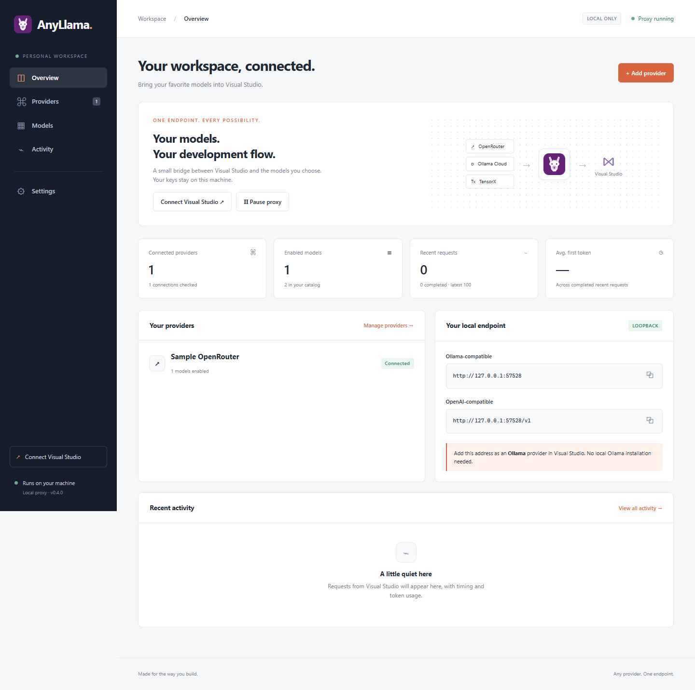

# AnyLlama

Your models. One local endpoint for Visual Studio 2026 and VS Code.

AnyLlama is a local application that presents cloud providers and local model
servers through Ollama and Chat Completions APIs. It has 18 named
[provider profiles](docs/PROVIDERS.md), plus Custom OpenAI-compatible.
It includes an English web dashboard, a tray icon, a model picker and request diagnostics.

## Download and install

Download the package for your system from [GitHub Releases](https://github.com/pawelworyna/AnyLlama/releases):

- **Windows x64:** `AnyLlama.exe` or the `win-x64.zip` archive.
- **Windows ARM64:** the `win-arm64.zip` archive. Extract it and run `AnyLlama.exe`.
- **macOS Apple Silicon:** the `macos-arm64.zip` archive. Extract and open `AnyLlama.app`.
  The application is ad-hoc signed but is not notarized by Apple; macOS can block its first launch.
- **Debian / Ubuntu:** the `amd64.deb` or `arm64.deb` package for your processor. Install it with
  `sudo apt install ./anyllama_VERSION_ARCH.deb`, replacing the filename with the download.
  Builds target Ubuntu 22.04 or newer. Launch **AnyLlama** from your application menu or run
  `anyllama` in a terminal. On Linux a terminal remains open while the proxy runs; close it to exit.
  Linux requires a graphical browser and an unlocked Secret Service (for example GNOME Keyring)
  to store API keys. No Python installation is needed on any platform.

Start the app, add a provider, enable models and copy the local endpoint into your IDE.
On Windows and macOS the app lives in the system tray / menu bar.
See [provider setup and compatibility](docs/PROVIDERS.md) for cloud and local servers.



## Run from source

Install Python 3.13 and [uv](https://docs.astral.sh/uv/), then run:

```powershell
uv sync --frozen --group dev
uv run anyllama
```

The tray icon opens the dashboard. First launch opens a setup wizard:

1. Add your actual provider in AnyLlama, check the connection and enable the models you want.
2. In Visual Studio, open **Chat → model picker → Manage models → Add model provider**.
3. Select **Ollama** and enter the AnyLlama endpoint shown in **Overview** with `/v1`
   appended, for example `http://127.0.0.1:11434/v1` with the default port. Click **Add**.
4. Pick an enabled model from the Ollama provider's list. Models from different providers
   appear together under this connection. If you change the selection in AnyLlama and VS
   still shows the old list, remove and add the Ollama provider again using the same endpoint.

Models use readable, stable connection prefixes such as `lm-studio/vendor/model`. Connections
with the same name receive distinct prefixes. Renaming a connection does not change its prefix,
and previously configured model IDs continue working. Retired prefixes remain reserved after
removing a connection, so an old selection cannot silently point to a different provider. VS may
need to reload its model list to display the new names.

No Ollama installation is needed. Provider keys are configured only in AnyLlama. The
OpenAI-compatible API also uses the `/v1` address (use a nonempty placeholder key only
if that client requires one). Copy the actual endpoint from the dashboard if you changed ports.

For a foreground server without a tray icon:

```powershell
uv run anyllama --headless
```

The dashboard URL printed by this command contains a local login token. Treat it as private.
The UI also has a **Connect Visual Studio** guide. Model changes may require refreshing
the model list in Visual Studio. Ollama itself does not need to be installed.

If models are greyed out with **“Your own models work only in Agent (Preview)”**, start
a new Agent (Preview) thread. In VS 18.11, if that entry is absent, check **Tools → Options →
GitHub → Copilot → Copilot Chat → Use new Copilot chat experience**, restart Visual Studio
after changing the option, then create a new thread. Existing models do not need to be duplicated.

If the new chat shows **“Your active GitHub account is blocked from using preview Copilot
features”**, check **Editor preview features** in your [GitHub Copilot settings](https://github.com/settings/copilot/features)
using the account signed into VS, or ask your organization administrator about its policy.
Availability depends on the IDE session and account policy. See the validation notes for
which flows were tested with fixtures and which were observed in real clients.

Microsoft documents the [BYOK session requirement](https://learn.microsoft.com/en-us/visualstudio/ide/copilot-select-add-models?view=visualstudio)
and the [VS 18.11 chat setting](https://devblogs.microsoft.com/visualstudio/visual-studio-october-update-compare-commits-to-your-code-resolve-conflicts-in-bulk-keep-coding/).

## Build and test

```powershell
uv run pytest
uv run ruff check .
uv run python scripts/build.py
uv run python scripts/package_release.py
```

For the browser and frozen-app acceptance checks, see [validation](docs/VALIDATION.md).

The Windows build creates `dist/<version>/AnyLlama.exe` with its own Python runtime.
No administrator rights or Python installation are required to run the EXE.
Autostart is opt-in on Windows. Exit through the tray menu to stop the application completely.
If another application occupies the default port, run `AnyLlama.exe --port 11436`
once to save a different port, then copy the updated endpoint into Visual Studio.
To upgrade, exit the previous application through its tray menu before launching the new EXE.
Keep the default data directory to retain providers, keys and model selections.

## Updates and GitHub releases

**Settings → Updates** checks for a newer stable release in `pawelworyna/AnyLlama` and
links to GitHub for manual download. Automatic checks are enabled by default and can be
disabled there. No provider keys, prompts or conversation data are sent to GitHub.
The application never installs or runs a downloaded update.

Maintainers can bump versions through **Prepare release** and review/merge the generated PR;
**Release** then tests, builds and publishes packages and SHA-256 checksums automatically.
See [publishing and release instructions](docs/RELEASING.md).

Since v0.2.2, the default port is **11434**, matching
[Ollama's standard address](https://docs.ollama.com/api/introduction).
Explicitly saved ports are preserved. Configurations with no saved port use the new
default on the next launch; update IDE connections that still point to 11435.
To switch an explicitly saved port, open
**Settings → Use Ollama default (11434) → Save settings**, then restart AnyLlama.
Use `http://localhost:11434` for Ollama clients and `http://localhost:11434/v1` for
OpenAI clients. Port 11434 must be free; quit an existing Ollama server first if needed.
Update any IDE connections still using the previous port. This preset does not edit
Visual Studio configuration or bypass its Copilot account feature restrictions.
Microsoft's documented flow still requires adding a provider in Manage Models;
automatic registration is not guaranteed merely by choosing the standard port.

## Request metrics (v0.2.0)

**Activity** shows each real request's status, first token time, total duration,
output tokens/second, input/output token counts and cost in USD. No benchmark requests
are generated. Optional cache and reasoning counts appear under usage; reasoning is
already included in output tokens.

- **Reported** cost uses the provider's `usage.cost` (OpenRouter/TensorX in USD; custom
  providers must explicitly report `currency: USD`).
- **Estimate** uses the token counts and rates available when the request ran. Catalog
  rates come from OpenRouter `/models` or TensorX `/model/info`. To enter manual rates,
  open **Models → Configure → Pricing**, in USD per million tokens. Changed fields become
  overrides; unchanged catalog rates continue updating. Blank means unknown, zero means free.
  Positive cache usage needs a matching cache rate. Estimates exclude taxes, credits,
  subscriptions and any charges not represented by these rates.
- **≈ tok/s** is `(output tokens − 1) / seconds from first to last output fragment`.
  It includes reasoning and tools; chunk buffering affects its accuracy. Native Ollama
  generation duration takes precedence when available. Single-chunk or nonstreamed
  requests without native timing have no speed estimate. First token time measures
  the first content, reasoning or tool fragment, excluding role-only frames.

Missing data stays **—**. Failed/cancelled calls retain reported usage/cost if received,
but get no estimated cost or throughput. Historical records keep their original fields;
new metrics are not reconstructed. The schema upgrades automatically on first launch.

## Data and privacy

Configuration and the most recent 1,000 request summaries stay on your device. The data
directory is `%LOCALAPPDATA%\AnyLlama` on Windows, `~/Library/Application Support/AnyLlama`
on macOS and `$XDG_DATA_HOME/AnyLlama` (normally `~/.local/share/AnyLlama`) on Linux.
API keys are stored under service `AnyLlama` in Windows Credential Manager, macOS Keychain,
or Linux Secret Service; they are never returned to the dashboard or configuration export.
Activity stores timing, status, token counts and numeric cost measurements, not prompts or responses. Provider errors
are summarized locally without persisting upstream response bodies.

Both proxy and administration listen only on loopback. The dashboard uses a private
bootstrap link, an HttpOnly session and CSRF protection. There is no LAN mode.
Requests go directly to the selected provider; AnyLlama does not retry generations or
switch providers. Pausing leaves the dashboard available and rejects new inference requests.

## Compatibility

v0.1.1 includes the Visual Studio bare `/chat/completions` route,
a purple llama icon, and additional input/transport safeguards. See the
[design and security review](docs/REVIEW.md) for the exact limits of the security claims.

Target: Visual Studio Community 2026 18.11.2, including Agent tool calls. Protocol tests
use controlled provider fixtures; live provider and Visual Studio acceptance is tracked
separately in `docs/VALIDATION.md`. A passing mock test is not live certification.

Models expose their advertised capabilities. Unknown capabilities remain unknown and
can be overridden in Models. Supporting tools is necessary but does not guarantee that
every model will perform well in Visual Studio Agent. Reasoning signatures or proprietary
state cannot always be translated between protocols; unsupported replays fail explicitly.
Custom providers support Chat Completions, not the Responses or Anthropic Messages API.

No local model downloads, embeddings, inline code completions, LAN sharing,
automatic installation of updates or automated Visual Studio configuration edits are included.

## License and contributions

[MIT](LICENSE). See [contributing](CONTRIBUTING.md) and [security reporting](SECURITY.md).
Dependencies retain their own licenses, included in release third-party notices.

Protocol references: [Ollama](https://docs.ollama.com/api/chat),
[OpenRouter](https://openrouter.ai/docs/guides/features/tool-calling),
[TensorX](https://docs.tensorx.ai/api-reference/models).
